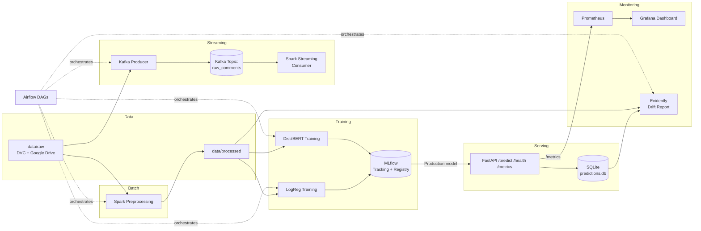

# X Posts Sentiment Analysis - MLOps Project

Team 42 project for DA5402W. We are building an end-to-end MLOps pipeline
that classifies text posts into emotions (like joy, anger, sadness, etc.)
using the dair-ai/emotion dataset with technologies - Kafka, Spark, MLflow, Airflow, FastAPI and Prometheus/Grafana

## Team

- Aksshay P DA25M539
- Shayan Sarkar DA25M618
- Subramanian Ganesh DA25M626
- Akash N DA25M536

## What we are planning to use

- **Kafka** - to simulate streaming posts
- **Spark** - for preprocessing the data
- **MLflow** - to track our model experiments
- **DVC** - to version our data and models
- **Airflow** - to automate and schedule the pipeline
- **FastAPI** - to serve the trained model as an API
- **Docker** - to containerize everything
- **Prometheus + Grafana** - for monitoring the API
- **GitHub Actions** - for CI/CD

## System Architecture

Here's how everything fits together, roughly in the order data flows
through the system:

1. **Data ingestion** - `scripts/download_data.py` pulls the raw
   dair-ai/emotion dataset. Raw data is tracked with DVC and stored in a
   shared Google Drive remote (not committed to Git, since it's large and
   binary).
2. **Streaming (Kafka)** - `kafka/producer.py` replays dataset rows into a
   Kafka topic (`raw_comments`) to simulate posts arriving live.
   `kafka/consumer_spark.py` reads from that topic using Spark Structured
   Streaming, cleans the text, and writes it out.
3. **Batch preprocessing (Spark)** - `processing/preprocess.py` cleans
   the raw dataset (lowercasing, removing links/junk characters, dropping
   nulls) using Apache Spark, producing `data/processed`. This is run as
   a DVC pipeline stage so it's versioned and reproducible.
4. **Model training (MLflow)** - `training/train_logreg.py` and
   `training/train_distilbert.py` each train a model on the processed
   data. Both log their parameters, metrics, and the trained model itself
   to MLflow, which also acts as a model registry.
5. **Orchestration (Airflow)** - three DAGs automate the steps above:
   `data_ingest_dag` (Kafka), `train_pipeline_dag` (preprocess + train
   both models), and `retrain_dag` (checks for drift, retrains if
   needed, and automatically promotes the retrained model if it's at
   least as good as the one currently in production).
6. **Model promotion** - once trained, the better-performing model
   version is manually promoted to "Production" in the MLflow Model
   Registry.
7. **Serving (FastAPI)** - `serving/app.py` loads the Production model
   from MLflow and exposes `/predict`, `/health`, and `/metrics`
   endpoints. Every prediction is logged to a local SQLite database
   (`monitoring/predictions.db`) and to Prometheus metrics.
8. **Monitoring (Prometheus + Grafana)** - Prometheus scrapes the API's
   `/metrics` endpoint; Grafana visualizes latency, throughput, error
   rate, and per-class prediction counts on a pre-built dashboard.
9. **Drift detection** - `monitoring/drift_detector.py` compares the
   distribution of recent predictions against the original training data.
   It computes a Population Stability Index (PSI) score - a standard way
   to measure how much a distribution has shifted - and also runs an
   Evidently drift report as a second check. If PSI crosses a threshold,
   the model is flagged as possibly needing retraining. Every check is
   saved to a history file so we can see drift trends over time.
10. **Dashboard (Streamlit)** - `dashboard/app.py` is a small web app
    that shows the current drift status, prediction distributions, drift
    trends over time, everything registered in the MLflow model registry,
    and retraining history. It also has buttons to send test traffic and
    manually trigger a drift check, which is handy for demos.
11. **CI/CD (GitHub Actions)** - every push/PR runs linting and tests,
    and pushes on `main` build and publish a Docker image of the API to
    GitHub Container Registry.

Everything except the Python virtual environment and the training/data
scripts runs as a Docker container, wired together with Docker Compose.

### Architecture Diagram



## Folder Structure and Dependencies

```
.
├── airflow/
│   ├── Dockerfile          # custom Airflow image (adds Java for PySpark + our requirements.txt)
│   └── dags/                # data_ingest_dag.py, train_pipeline_dag.py, retrain_dag.py
├── kafka/
│   ├── producer.py           # replays data/raw into the raw_comments Kafka topic
│   └── consumer_spark.py     # Spark Structured Streaming consumer
├── processing/
│   └── preprocess.py         # Spark batch preprocessing (DVC pipeline stage)
├── training/
│   ├── train_logreg.py       # TF-IDF + Logistic Regression, logs to MLflow
│   └── train_distilbert.py   # fine-tuned DistilBERT, logs to MLflow
├── monitoring/
│   ├── prometheus.yml        # Prometheus scrape config
│   ├── drift_detector.py     # main drift check: PSI + Evidently, writes history
│   ├── drift_report.py       # older/simpler entry point, now just calls drift_detector.py
│   ├── promote.py            # helper script to promote a model version to Production
│   └── grafana/              # Grafana dashboard + datasource provisioning
├── dashboard/
│   ├── app.py                 # Streamlit dashboard: drift status, trends, registry, retrain history
│   └── Dockerfile             # image for the dashboard service
├── serving/
│   ├── app.py                 # FastAPI app: /predict, /health, /metrics, /drift-status, /drift-history
│   └── predict.py             # loads the Production model from MLflow and runs inference
├── scripts/
│   ├── download_data.py      # downloads the dair-ai/emotion dataset
│   ├── check_data.py         # sanity-checks the downloaded data
│   └── simulate_drift.py     # sends normal or drifted test traffic to the API, for demos
├── tests/                     # pytest unit/integration tests
├── .github/workflows/ci.yml   # CI/CD: lint, test, Docker build + push to GHCR
├── dvc.yaml, dvc.lock         # DVC pipeline stage definitions
├── docker-compose.yml         # brings up all services (Kafka, MLflow, Airflow, API, Prometheus, Grafana)
├── Dockerfile                 # image for the FastAPI serving app
├── requirements.txt           # Python dependencies (pinned versions)
└── conftest.py                 # marks the repo root as importable for pytest
```

**Key dependencies** (full pinned list in `requirements.txt`): PySpark,
confluent-kafka, MLflow, DVC (+ Google Drive support), scikit-learn,
transformers + accelerate (for DistilBERT), FastAPI + uvicorn, Prometheus
client libraries, Evidently, pytest, and ruff for linting.

## Data & Model Storage

We use DVC to version our dataset and models. The actual files are stored
in a shared Google Drive folder (not in Git):
https://drive.google.com/drive/folders/1RiJTIe29SK3OjqTYNKjv1E4qJbCE5Cf9

To pull the data after cloning this repo, run `dvc pull`. The DVC remote
credentials are already set up in `.dvc/config`, so this should work out
of the box for anyone with access to this (private) repo - no extra setup
needed. The first time you run it, a browser window will pop up asking
you to log in with Google - just approve it.

## Setup and Installation

This section walks through everything from an empty folder to a fully
running pipeline. It assumes you have Python 3.12, Docker Desktop, and
git already installed on your machine.

### 1. Clone the repo

```bash
git clone https://github.com/aksshay07/DA5402W_project_42_da25m539.git
cd DA5402W_project_42_da25m539
```

### 2. Set up a Python virtual environment

We use a virtual environment so this project's Python packages don't mix
with other projects on your machine.

```bash
python3 -m venv .venv
source .venv/bin/activate
pip install -r requirements.txt
```

You'll need to run `source .venv/bin/activate` again every time you open
a new terminal window to work on this project.

### 3. Get the data

The dataset (dair-ai/emotion, a set of short text posts each labeled with
an emotion) isn't stored directly in Git - it's tracked with a tool called
DVC and the actual files live in a shared Google Drive folder. This keeps
the Git repo small and lets everyone stay in sync on the same data.

First, download the raw dataset:

```bash
python scripts/download_data.py
python scripts/check_data.py
```

If you'd rather pull the data that's already tracked by DVC (recommended,
since it saves you from re-downloading):

```bash
dvc pull
```

The DVC remote credentials are already committed in `.dvc/config`
(this repo is private, so that's fine), so `dvc pull`/`dvc push` should
work right away - the first time you run either, a browser window will
pop up asking you to log in with Google, just approve it.

If you'd rather not use the shared Drive remote at all, everything is
also fully reproducible from scratch - `python scripts/download_data.py`
followed by `dvc repro` will regenerate the processed data and both
trained models from the public dair-ai/emotion dataset.

### 4. Preprocess the data with Spark

This step cleans up the raw text (lowercasing, removing links/junk
characters, etc.) using Apache Spark, and saves the cleaned data to
`data/processed`.

```bash
dvc repro preprocess
```

We use `dvc repro` instead of running the script directly, because it
lets DVC keep track of exactly which version of the code produced which
version of the data - so if `data/raw` or `processing/preprocess.py`
changes later, DVC knows this step needs to be re-run.

### 5. Train the models

We train two different models on the cleaned data and log everything
(metrics, parameters, the trained model itself) to MLflow so we can
compare them later.

First, start MLflow so it's there to receive the logs. You can either run
it directly on your machine:

```bash
mlflow ui --port 5001
```

or run it inside Docker (closer to how it runs in production for this
project):

```bash
docker compose up -d mlflow
```

Then train both models:

```bash
dvc repro train_logreg        # a simple TF-IDF + Logistic Regression model
dvc repro train_distilbert    # a fine-tuned DistilBERT transformer model
```

DistilBERT takes a lot longer to train than Logistic Regression (tens of
minutes on a normal laptop CPU), since it's a much bigger model.

Once both are done, open the MLflow UI at `http://localhost:5001` (or
`5000` if you ran it directly) in your browser to compare their accuracy
and F1 scores.

### 6. Promote the best model to "Production"

MLflow keeps every model version you've ever trained, but the serving API
only loads whichever version is marked as "Production." This is a manual
step - someone looks at the metrics in the MLflow UI and decides which
version is actually good enough to serve.

You can do this from the MLflow UI (Models tab, pick a version, click
"Transition to Production"), or via the API:

```bash
curl -X POST "http://localhost:5001/api/2.0/mlflow/model-versions/transition-stage" \
  -H "Content-Type: application/json" \
  -d '{
    "name": "sentiment-distilbert",
    "version": "1",
    "stage": "Production",
    "archive_existing_versions": true
  }'
```

### 7. Run the API

Once a model is promoted, you can start the FastAPI app that serves
predictions:

```bash
export MLFLOW_TRACKING_URI=http://localhost:5001
uvicorn serving.app:app --host 0.0.0.0 --port 8000
```

Try it out:

```bash
curl http://localhost:8000/health

curl -X POST http://localhost:8000/predict \
  -H "Content-Type: application/json" \
  -d '{"text": "I am so incredibly happy today, everything is going great!"}'
```

You can also open `http://localhost:8000/docs` in a browser for an
interactive page where you can try the API without typing curl commands.

### 8. Bring up the full pipeline with Docker

Instead of running each piece by hand, you can bring up everything at
once with Docker Compose - this starts Kafka, MLflow, the API, Airflow,
Prometheus, Grafana, and the Streamlit dashboard all together, wired up
to talk to each other:

```bash
docker compose up -d
docker compose ps   # check that everything started correctly
```

To stop everything:

```bash
docker compose down
```

### 9. Kafka streaming (simulating live data)

To try out the streaming part of the pipeline (replaying the dataset as
if it were arriving in real time):

```bash
docker compose up -d zookeeper kafka

python kafka/producer.py         # sends rows into the Kafka topic
python kafka/consumer_spark.py   # reads them back out and cleans them with Spark
```

### 10. Airflow (automating everything)

Airflow lets us schedule and automate the steps above instead of running
them by hand. The first time you set it up:

```bash
docker compose up -d postgres
docker compose up airflow-init     # one-time setup: creates the database and an admin user
docker compose up -d airflow-webserver airflow-scheduler
```

Then open `http://localhost:8080` in a browser and log in with username
`admin` and password `admin`. You'll see three DAGs (Airflow's name for
an automated pipeline):

- **data_ingest_dag** - replays the dataset into Kafka
- **train_pipeline_dag** - preprocesses the data and trains both models
- **retrain_dag** - checks for data drift and retrains if needed

DAGs start out paused - toggle one on, then click the play button to
trigger it manually.

### 11. Monitoring - Prometheus and Grafana

Once the API is up and Prometheus/Grafana are running, you can watch
live metrics (how many predictions were made, how fast, error rates,
etc.):

```bash
docker compose up -d mlflow api prometheus grafana
```

- Prometheus: `http://localhost:9090`
- Grafana: `http://localhost:3000` (username `admin`, password `admin`) -
  open Dashboards -> Sentiment API to see the pre-built dashboard.

### 12. Drift detection

This checks whether the data the API is currently seeing looks
meaningfully different from the data the models were trained on - a
sign that the models might need retraining. We use a metric called PSI
(Population Stability Index) as the main decision signal, plus an
Evidently drift report as a backup check.

```bash
python monitoring/drift_detector.py
```

By default it looks at the last 200 predictions logged in
`monitoring/predictions.db` and compares their label distribution
against the training data in `data/processed`. If there aren't 200
predictions yet, it just says so and skips the check rather than
erroring out.

Each run writes the latest result to `monitoring/drift_result.json` and
also appends it to `monitoring/drift_history.jsonl`, so we can track
drift over time instead of only seeing the most recent check.

**Trying it out with fake traffic:** if you don't have real predictions
logged yet, there's a script that sends realistic test text to the API
for you:

```bash
# Send normal, balanced traffic - drift should stay low
python scripts/simulate_drift.py --mode normal --count 200
python monitoring/drift_detector.py

# Send traffic skewed toward anger/fear - this should trigger drift
python scripts/simulate_drift.py --mode drift --count 300
python monitoring/drift_detector.py
```

**Checking drift through the API instead of the command line:**

```bash
curl http://localhost:8000/drift-status              # latest result + live distribution
curl "http://localhost:8000/drift-history?limit=10"   # recent history
curl http://localhost:8000/prediction-counts           # how many predictions, per label
```

**Automatic retraining:** the `retrain_dag` in Airflow runs this same
drift check first. If drift is detected, it retrains both models, then
compares the new DistilBERT model's macro F1 score against whatever's
currently in Production. If the new one is at least as good, it's
automatically promoted and the old version is archived; if not, the
current Production model is left alone. Either way, the decision gets
logged to `monitoring/retrain_history.jsonl`.

### 13. Dashboard

There's a Streamlit dashboard that pulls all the monitoring pieces
together into one page - useful for demos since you don't have to run
curl commands to see what's going on.

```bash
docker compose up -d dashboard
```

Open `http://localhost:8501` in a browser. It shows:

- Current drift status (PSI score, threshold, how many samples it looked at)
- Reference vs. current prediction distribution, side by side
- A chart of PSI over time
- Every model registered in MLflow, with their accuracy/F1 scores and stage
- Buttons to send test traffic and trigger a drift check, without needing a terminal
- A log of past retraining decisions (old vs. new model, whether it got promoted)

### 14. Running tests and checks

Before pushing code, you can run the same checks our CI pipeline runs
automatically on GitHub:

```bash
ruff check .          # lint - catches style issues and simple bugs
pytest tests/ -v       # runs our automated tests
```

These also run automatically on every push and pull request via GitHub
Actions (see `.github/workflows/ci.yml`).
